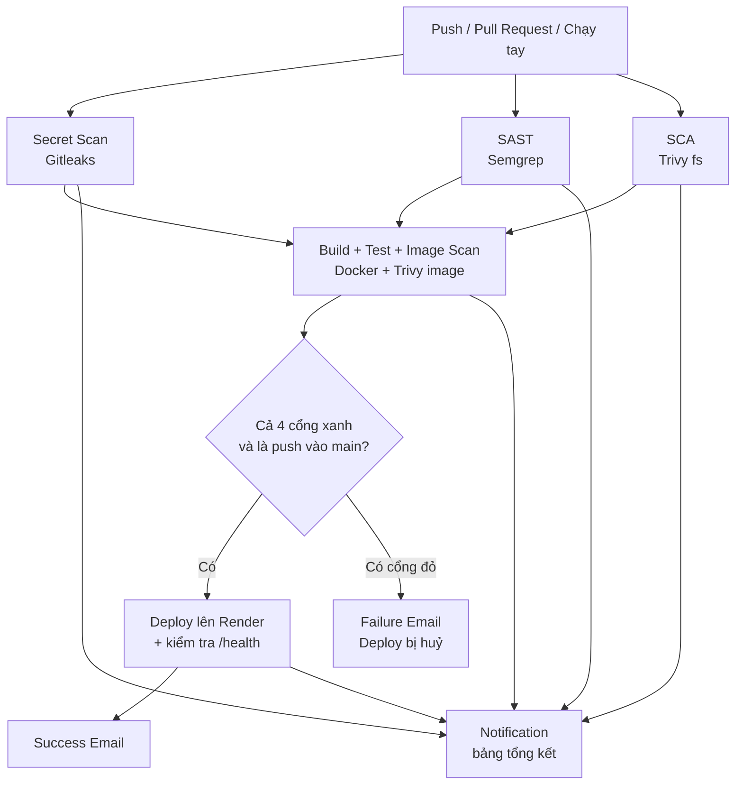
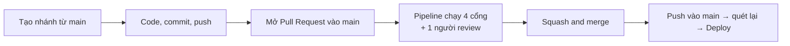

# DevSecOps Pipeline – Đường hầm CI/CD tích hợp kiểm thử an toàn tự động

> **Đồ án môn An toàn Mạng** — Triển khai đường hầm tích hợp & kiểm thử an toàn tự động (DevSecOps Pipeline / CI-CD Security)  
> **Nhóm thực hiện:** Bùi Huỳnh Tuấn Thành – Phan Minh Thắng – Trần Khánh Tâm &nbsp;|&nbsp; **Năm:** 2026

---

## 1. Giới thiệu

**DevSecOps** là cách làm phần mềm đưa việc kiểm tra bảo mật vào ngay trong quy trình tích hợp và triển khai liên tục (CI/CD), thay vì để đến cuối mới kiểm tra. Bảo mật được kiểm tra **tự động, mỗi lần code thay đổi**, và **càng sớm càng tốt** (shift-left).

Repo này gồm:

- Một ứng dụng web mẫu **Bảng Thời Tiết Mini (Weather Dashboard)** (`app.py`, `templates/index.html`) đóng gói bằng Docker (`Dockerfile`).
- Một workflow GitHub Actions (`.github/workflows/main.yml`) chạy 4 lớp quét bảo mật, rồi deploy lên Render.
- Bốn **script cổng kiểm soát** (`scripts/*_gate.py`). Mỗi script đọc báo cáo của công cụ quét, ghi báo cáo dễ đọc lên trang kết quả của GitHub, rồi quyết định **cho qua** hay **chặn**.

## 2. Mục tiêu

| Mục tiêu | Cách đạt được |
|---|---|
| CI/CD hoàn chỉnh trên GitHub Actions | Workflow `main.yml`: quét, build, kiểm thử, deploy, thông báo |
| SAST: quét mã nguồn tìm lỗi lập trình | Semgrep |
| SCA: phát hiện lỗ hổng trong thư viện bên thứ ba | Trivy (chế độ `fs`) |
| Secret Scanning: chặn lộ API key, mật khẩu | Gitleaks |
| Container Security: quét lỗ hổng trên Docker image | Trivy (chế độ `image`) |
| Quality Gate: tự động dừng Build/Deploy khi có lỗ hổng High/Critical | 4 script cổng + cơ chế `needs` của GitHub Actions |
| Cảnh báo khi bị chặn | Email tự động (Failure Email) |

## 3. Phạm vi áp dụng

Pipeline được xây dựng và **kiểm chứng trên đúng một loại dự án**:

| Thành phần | Phạm vi đã kiểm chứng |
|---|---|
| Ngôn ngữ, framework | Python 3.11, Flask, chạy bằng gunicorn |
| Khai báo thư viện | `requirements.txt` ghi phiên bản cố định (`==`) |
| Đóng gói | Một `Dockerfile` ở thư mục gốc |
| Nơi chứa code | GitHub, tài khoản cá nhân |
| CI/CD | GitHub Actions |
| Nơi chạy ứng dụng | Render (Web Service, Docker), gọi qua Deploy Hook |
| Email cảnh báo | Gmail (SMTP, App Password) |

## 4. Quy mô áp dụng

| Tiêu chí | Quy mô phù hợp |
|---|---|
| Số repo | 1 repo |
| Số service | 1 ứng dụng web, 1 Dockerfile (không phải monorepo, không phải microservice) |
| Đội ngũ | Nhóm nhỏ (khoảng 2–5 người), làm theo **GitHub Flow** |
| Môi trường | 1 môi trường production (không có staging) |
| Chi phí | Dùng được hoàn toàn bằng gói miễn phí: GitHub Actions cho repo public, Render free, Gmail |

## 5. Điều kiện sử dụng

| Điều kiện | Lý do |
|---|---|
| Repo trên GitHub, bật GitHub Actions | Toàn bộ pipeline chạy trên GitHub Actions |
| Nhánh chính tên `main`, làm việc theo GitHub Flow | Trigger và điều kiện Deploy gắn với `main` |
| Repo thuộc **tài khoản cá nhân**, hoặc thuộc tổ chức nhưng có license Gitleaks | `gitleaks-action` miễn phí cho tài khoản cá nhân; repo thuộc tổ chức phải có `GITLEAKS_LICENSE` |
| Có quyền admin repo | Để tạo Secrets và Rulesets |

## 6. Luồng tổng quát

### 6.1. Sơ đồ pipeline



- **Tầng 1** (Secret, SAST, SCA) chạy **song song**.
- **Container** chỉ chạy khi cả 3 cổng tầng 1 xanh.
- **Deploy** chỉ chạy khi cả 4 cổng xanh **và** sự kiện là push vào `main`.
- Có bất kỳ cổng nào đỏ, các bước phía sau bị bỏ qua, và **Failure Email** được gửi đi.

### 6.2. Quy trình làm việc (GitHub Flow)



| Sự kiện | Nhánh | Pipeline làm gì |
|---|---|---|
| `push` | `tv1-deploy`, `tv2-deploy`, `tv3-deploy` | Quét, báo lỗi sớm. Không deploy |
| `pull_request` | vào `main` | Quét đủ 4 cổng. **Rulesets khoá nút Merge nếu có cổng đỏ hoặc chưa được duyệt** |
| `push` | `main` (sinh ra khi merge PR) | Quét lần cuối, xanh thì **Deploy** |
| `workflow_dispatch` | bấm tay | Quét, riêng Gitleaks quét toàn bộ lịch sử của mọi nhánh |

## 7. Luồng chi tiết

### 7.1. Các job trong `main.yml`

| Job | Các bước chính | Phụ thuộc |
|---|---|---|
| **Secret Scan** | Checkout toàn bộ lịch sử → Gitleaks ghi `results.sarif` → `secret_gate.py` → lưu artifact | — |
| **Static Code Analysis** | Cài Semgrep 1.183.0 → quét với bộ rule `p/security-audit`, `p/owasp-top-ten` → `sast_gate.py` → lưu artifact | — |
| **Software Composition Analysis** | Trivy `fs` quét `requirements.txt` → `sca_gate.py` → lưu artifact | — |
| **Build And Scan Container** | `docker build` → chạy thử, gọi `/health` → kiểm tra user `appuser` → Trivy quét image → `container_gate.py` → lưu artifact | 3 job tầng 1 |
| **Deploy to Production** | Gọi Render Deploy Hook kèm mã commit → (tuỳ chọn) chờ `/health` trả đúng commit | 4 job quét, chỉ khi push vào `main` |
| **Notification** | Ghi bảng tổng kết kết quả các job | Luôn chạy |
| **Failure Email** | Gửi email "DEPLOY BLOCKED" | Khi có job thất bại |
| **Success Email** | Gửi email "DEPLOY SUCCEEDED" | Khi Deploy thành công |

### 7.2. Cách một cổng hoạt động

Mọi cổng đều theo cùng một khuôn:

```text
Công cụ quét ghi báo cáo đầy đủ (không tự chặn)
        ↓
Script cổng đọc báo cáo → phân loại → ghi Summary + gate-result.json
        ↓
Quyết định: PASS / PASS_WITH_WARNINGS (exit 0)   hoặc   BLOCKED / ERROR (exit 1)
        ↓
exit 1 → job đỏ → các job phụ thuộc (needs) bị bỏ qua → không Deploy
```

Nguyên tắc **fail-closed**: báo cáo thiếu, hỏng, hoặc không quét được gì đều ra `ERROR` và **chặn**, không bao giờ được coi là "sạch".

### 7.3. Chính sách chặn

| Cổng | Bị chặn (BLOCKED) | Chỉ cảnh báo | Chỉ liệt kê (mục thu gọn) |
|---|---|---|---|
| **Secret** | **Mọi** secret tìm thấy | — | — |
| **SAST** | Lỗi mức HIGH/CRITICAL | Lỗi chưa xác định được mức độ (UNKNOWN) | MEDIUM, LOW |
| **SCA** (`BLOCK_UNFIXED: 'true'`) | HIGH/CRITICAL, **kể cả khi chưa có bản vá** | UNKNOWN | MEDIUM, LOW |
| **Container** (`BLOCK_UNFIXED: 'false'`) | HIGH/CRITICAL **đã có bản vá** | HIGH/CRITICAL chưa có bản vá; UNKNOWN | MEDIUM, LOW |

Lý do SCA và Container khác nhau:

- Thư viện trong `requirements.txt` do nhóm **tự chọn**, nên lỗ hổng chưa có bản vá vẫn xử lý được (đổi thư viện khác). Vì vậy SCA chặn cả loại này.
- Gói hệ điều hành trong image do **Debian** phát hành. Khi Debian chưa có bản vá, đây là điều không tự sửa được. Vì vậy Container chỉ cảnh báo loại này.

### 7.4. Cổng chặn lần deploy mới, không tắt ứng dụng đang chạy

Pipeline chỉ chạy khi có code mới. Cổng đỏ nghĩa là **bản mới không được đưa lên**; bản đang chạy trên Render vẫn hoạt động bình thường. Nếu một CVE mới công bố làm cổng chặn cả những thay đổi không liên quan ("đóng băng deploy"), cách xử lý đúng là phân tích rủi ro rồi **miễn trừ có thời hạn** cho đúng CVE đó (xem [Hướng mở rộng](#13-hướng-mở-rộng)), không phải tắt cổng.

### 7.5. Các biện pháp bảo vệ chính pipeline

| Biện pháp | Mục đích |
|---|---|
| Ghim mọi action bằng mã SHA (không dùng `@master`, `@v4`) | Chống tấn công chuỗi cung ứng qua action bị chiếm quyền |
| `permissions: contents: read` (Deploy dùng `permissions: {}`) | Token của pipeline chỉ có quyền tối thiểu |
| `persist-credentials: false` | Không để token lại trong thư mục code |
| Deploy Hook, mật khẩu email lưu trong **GitHub Secrets** | Không có bí mật nào nằm trong file của repo public |
| Container chạy bằng user `appuser` | Không chạy ứng dụng bằng root |
| `apt-get upgrade` khi build, gỡ `pip`/`setuptools`/`wheel` khỏi image | Giảm lỗ hổng trong image |
| Render tắt Auto-Deploy | Chỉ deploy khi pipeline đã qua đủ 4 cổng |
| Rulesets cho `main` | Bắt buộc PR, 4 cổng xanh, 1 người duyệt; cấm force push, cấm xoá nhánh |

## 8. Phương pháp và công nghệ

| Phương pháp | Công cụ | Quét cái gì | Đọc từ | Mã nguồn công cụ |
|---|---|---|---|---|
| Secret Scanning | **Gitleaks** 8.24.3 (qua `gitleaks-action` v3.0.0) | API key, token, mật khẩu trong nội dung file của các commit | Lịch sử Git | [gitleaks/gitleaks](https://github.com/gitleaks/gitleaks), [gitleaks/gitleaks-action](https://github.com/gitleaks/gitleaks-action) |
| SAST | **Semgrep** Community Edition 1.183.0 | Mẫu code nguy hiểm: SQL injection, command injection, cấu hình không an toàn… | Mã nguồn | [semgrep/semgrep](https://github.com/semgrep/semgrep), bộ rule: [semgrep/semgrep-rules](https://github.com/semgrep/semgrep-rules) |
| SCA | **Trivy** (chế độ `fs`, qua `trivy-action` v0.36.0) | Lỗ hổng (CVE) của thư viện **khai báo** trong `requirements.txt` | File khai báo thư viện | [aquasecurity/trivy](https://github.com/aquasecurity/trivy), [aquasecurity/trivy-action](https://github.com/aquasecurity/trivy-action) |
| Container Security | **Trivy** (chế độ `image`) | Lỗ hổng của **gói hệ điều hành** (Debian) và **mọi thư viện Python đã cài** trong image, kể cả thư viện con | Docker image sau khi build | như trên |
| Quality Gate | **4 script Python** do nhóm viết | Đọc báo cáo, phân loại, quyết định chặn | Báo cáo JSON/SARIF | `scripts/` trong repo này |

Công nghệ nền tảng:

| Thành phần | Công nghệ | Liên kết |
|---|---|---|
| CI/CD | GitHub Actions | [docs.github.com/actions](https://docs.github.com/en/actions) |
| Lấy code, cài Python, lưu artifact | `actions/checkout`, `actions/setup-python`, `actions/upload-artifact` | [actions/checkout](https://github.com/actions/checkout), [actions/setup-python](https://github.com/actions/setup-python), [actions/upload-artifact](https://github.com/actions/upload-artifact) |
| Gửi email | `dawidd6/action-send-mail` qua Gmail SMTP | [dawidd6/action-send-mail](https://github.com/dawidd6/action-send-mail) |
| Đóng gói | Docker, base image `python:3.11-slim` | [hub.docker.com/_/python](https://hub.docker.com/_/python) |
| Ứng dụng mẫu | Flask 3.1.3, Werkzeug 3.1.9, gunicorn 26.2.0, requests 2.34.2, python-dotenv 1.2.4 | [pallets/flask](https://github.com/pallets/flask), [pallets/werkzeug](https://github.com/pallets/werkzeug), [benoitc/gunicorn](https://github.com/benoitc/gunicorn) |
| Nơi chạy ứng dụng | Render (Web Service, Deploy Hook) | [render.com/docs/deploy-hooks](https://render.com/docs/deploy-hooks) |

## 9. Hướng dẫn cài đặt và dùng thử

### 9.1. Lấy mã nguồn

Fork repo này về tài khoản GitHub cá nhân, hoặc clone về rồi đẩy lên một repo mới:

```bash
git clone https://github.com/TuanThanh05/devsecops-pipeline.git
cd devsecops-pipeline
```

Vào tab **Actions** của repo và bật GitHub Actions nếu được hỏi.

### 9.2. Tạo ứng dụng trên Render

1. Đăng nhập [render.com](https://render.com) → **New** → **Web Service** → kết nối repo GitHub.
2. Branch: `main`. Runtime: **Docker**. Render tự cung cấp biến `PORT`; `Dockerfile` đã dùng `${PORT:-5000}`.
3. Trong mục **Environment Variables**, thêm biến `OPENWEATHER_API_KEY` chứa API Key từ OpenWeatherMap để chức năng tra cứu thời tiết hoạt động.
4. Trong **Settings**, đặt **Auto-Deploy: Off**. Nếu để On, Render sẽ tự deploy mỗi khi có commit mới, **bỏ qua toàn bộ các cổng bảo mật**.
5. Trong **Settings → Deploy Hook**, sao chép URL. URL này có giá trị như mật khẩu: không dán vào code, không gửi công khai; nếu lỡ lộ thì tạo lại hook mới.

### 9.3. Khai báo Secrets và Variables trên GitHub

Vào **Settings → Secrets and variables → Actions**:

| Loại | Tên | Giá trị |
|---|---|---|
| Secret | `RENDER_DEPLOY_HOOK` | URL Deploy Hook của Render |
| Secret | `MAIL_USERNAME` | Địa chỉ Gmail dùng để gửi |
| Secret | `MAIL_PASSWORD` | App Password vừa tạo |
| Secret | `MAIL_TO` | Địa chỉ nhận cảnh báo |
| Secret (chỉ khi repo thuộc tổ chức) | `GITLEAKS_LICENSE` | License key của Gitleaks |
| Variable (tuỳ chọn) | `APP_URL` | URL ứng dụng trên Render, ví dụ `https://<tên-app>.onrender.com` |

Nếu đặt `APP_URL`, bước Deploy sẽ chờ tới khi `GET $APP_URL/health` trả về **đúng mã commit** vừa deploy (endpoint `/health` trong `app.py` đã trả kèm mã commit thông qua biến môi trường `RENDER_GIT_COMMIT`).

### 9.4. Bật Rulesets cho `main`

Vào **Settings → Rules → Rulesets → New branch ruleset**:

- Enforcement status: **Active**. Bypass list: để trống. Target: **default branch**.
- Bật: **Restrict deletions**, **Block force pushes**.
- Bật **Require a pull request before merging**: 1 approval, tick **Dismiss stale pull request approvals when new commits are pushed**, Allowed merge methods: **Squash**.
- Bật **Require status checks to pass**, thêm 4 check (nguồn: GitHub Actions): `Secret Scan`, `Static Code Analysis`, `Software Composition Analysis`, `Build And Scan Container`.

GitHub không cho người mở PR tự duyệt PR của mình, nên cần một thành viên khác duyệt.

### 9.5. Chạy script cổng trên máy

Các script chỉ dùng thư viện chuẩn của Python 3. Khi chạy trên máy (không có `GITHUB_STEP_SUMMARY`), script bỏ qua bước ghi Summary nhưng vẫn ghi `gate-result.json` cạnh file báo cáo và trả exit code.

```bash
# SCA
trivy fs --scanners vuln --list-all-pkgs --format json --output trivy-fs.json .
GATE_SEVERITY=HIGH,CRITICAL BLOCK_UNFIXED=true python3 scripts/sca_gate.py --report trivy-fs.json

# Container
docker build -t app:local .
trivy image --scanners vuln --list-all-pkgs --format json --output trivy-image.json app:local
GATE_SEVERITY=HIGH,CRITICAL BLOCK_UNFIXED=false python3 scripts/container_gate.py --report trivy-image.json

# SAST (script đọc thêm file semgrep-exit-code.txt cùng thư mục với báo cáo)
mkdir -p out
semgrep scan --config p/security-audit --config p/owasp-top-ten --metrics off --strict \
  --json-output out/semgrep.json . ; echo $? > out/semgrep-exit-code.txt
GATE_SEVERITY=HIGH,CRITICAL python3 scripts/sast_gate.py --report out/semgrep.json

# Secret
gitleaks detect --redact --report-format sarif --report-path results.sarif
python3 scripts/secret_gate.py --report results.sarif
```

## 10. Đọc kết quả

Mỗi lần chạy, mở tab **Actions** → chọn lần chạy → phần **Summary**.

| Cổng | Summary hiển thị |
|---|---|
| Secret | Phạm vi quét (commit của lần push / của PR / toàn bộ lịch sử mọi nhánh), người kích hoạt, bảng secret (rule, file, dòng, cột, commit, ngày), lý do chặn kèm mô tả rule, các bước khắc phục, fingerprint cho `.gitleaksignore` |
| SAST | Tổng quan, đếm theo mức độ, lỗi bị chặn (rule, file, dòng), cảnh báo, lỗi khi phân tích, mục thu gọn cho lỗi mức thấp |
| SCA, Container | Tổng quan (Container có thêm image và hệ điều hành nền), đếm theo mức độ, lỗ hổng bị chặn, cảnh báo kèm lý do, mục thu gọn cho MEDIUM/LOW |
| Notification | Bảng kết quả của mọi cổng và của Deploy |

Báo cáo gốc đầy đủ của từng công cụ được lưu thành **artifact** trong 14 ngày: `secret-scan-report`, `sast-scan-report`, `sca-scan-report`, `container-scan-report`. Mỗi artifact có thêm file `gate-result.json` (kết luận của cổng, cho máy đọc).

## 11. Cấu trúc thư mục

```text
.
├── .github/workflows/main.yml   # pipeline DevSecOps
├── scripts/
│   ├── secret_gate.py           # cổng Secret (đọc SARIF của Gitleaks)
│   ├── sast_gate.py             # cổng SAST (đọc JSON của Semgrep)
│   ├── sca_gate.py              # cổng SCA (đọc JSON của Trivy fs)
│   └── container_gate.py        # cổng Container (đọc JSON của Trivy image)
├── templates/
│   └── index.html               # giao diện ứng dụng mẫu Bảng Thời Tiết Mini
├── app.py                       # ứng dụng Flask mẫu (/, /api/weather và /health)
├── requirements.txt             # thư viện Python, ghi phiên bản cố định
├── Dockerfile                   # đóng gói ứng dụng (non-root appuser, gỡ pip/wheel)
├── .dockerignore
├── .gitignore
├── .env.example                 # file mẫu cấu hình biến môi trường
└── README.md
```

## 12. Giới hạn đã biết

| Giới hạn | Ảnh hưởng | Hướng xử lý |
|---|---|---|
| Gitleaks nhận diện secret theo mẫu | Mật khẩu tự đặt không theo mẫu nào có thể lọt qua | Kết hợp review code; GitHub Push Protection là lớp bảo vệ bổ sung |
| Gitleaks chỉ quét nội dung file trong commit | Secret dán vào lời commit, mô tả PR hay log không bị phát hiện | Thu hồi key, sửa nội dung trên GitHub |
| Push và PR chỉ quét các commit mới | Secret cũ đã nằm trong lịch sử `main` chỉ bị phát hiện khi chạy tay | Thu hồi key; với token giả hoặc đã thu hồi, dùng `.gitleaksignore` qua PR có duyệt |
| Trivy fs bỏ qua dòng không ghi phiên bản cố định | Thư viện ghi `>=` không được quét ở cổng SCA | Luôn ghi `==`; cổng Container vẫn quét thư viện đã cài thực tế |
| Trivy fs không thấy thư viện con | Lỗ hổng ở thư viện con chỉ bị bắt ở cổng Container (muộn hơn) | Dùng file khoá ghi đủ mọi thư viện (hướng mở rộng) |
| Render tự build lại image từ `Dockerfile` | Image đang chạy không phải chính image đã quét | Đẩy image đã quét lên registry, deploy theo digest (hướng mở rộng) |
| Tag `python:3.11-slim` được cập nhật định kỳ | Kết quả quét có thể đổi theo thời gian dù code không đổi | Ghim digest và cập nhật tự động bằng Dependabot (hướng mở rộng) |
| Cổng SAST chỉ dựa vào trường `impact` của rule | Một số lỗi có `impact` MEDIUM nhưng độ tin cậy cao sẽ không bị chặn | Xem xét thêm `confidence` và `severity` của Semgrep |
| Pipeline chỉ chạy khi có code mới | CVE công bố sau khi deploy không được phát hiện ngay | Quét định kỳ theo lịch (hướng mở rộng) |

## 13. Hướng mở rộng

- **Miễn trừ có thời hạn** (`.trivyignore` kèm ngày hết hạn, qua PR có duyệt) để xử lý tình trạng đóng băng deploy.
- **Quét định kỳ** (`schedule`) để phát hiện CVE mới cho bản đang chạy.
- **Đẩy image đã quét lên registry** (ví dụ GitHub Container Registry) và deploy đúng image theo digest.
- **Ghim digest base image** và dùng Dependabot để tự đề xuất cập nhật.
- **File khoá thư viện** (ví dụ `pip-compile`) để cổng SCA thấy cả thư viện con.
- **Base image tối giản** (distroless) để giảm số gói hệ điều hành.
- **DAST**: quét ứng dụng đang chạy (ví dụ OWASP ZAP) trên môi trường staging.
- **Giám sát** ứng dụng đang chạy (ví dụ Prometheus, Grafana).
- **Trình cài đặt tương tác**: hỏi người dùng về dự án, tự kiểm tra điều kiện ở [mục 5](#5-điều-kiện-sử-dụng), rồi sinh `main.yml` phù hợp để áp dụng pipeline cho dự án khác.

## 14. Ghi nhận công cụ của bên thứ ba

Nhóm **không** viết các công cụ quét bảo mật. Toàn bộ khả năng phát hiện lỗ hổng, secret và lỗi lập trình đến từ các dự án mã nguồn mở và dịch vụ bên dưới. Nhóm cảm ơn tác giả và cộng đồng của các dự án này.

**Phần nhóm tự thực hiện:**

- Thiết kế và cấu hình workflow `.github/workflows/main.yml`.
- Bốn script cổng trong `scripts/`: đọc báo cáo, phân loại, chính sách chặn, Summary, `gate-result.json`.
- `Dockerfile`, `.dockerignore`, ứng dụng mẫu `app.py` và `templates/index.html`.
- Chính sách Quality Gate, quy trình GitHub Flow, Rulesets, kịch bản kiểm thử.

**Công cụ và dịch vụ của bên thứ ba:**

| Công cụ | Tác giả / Chủ sở hữu | Giấy phép | Dùng để |
|---|---|---|---|
| [Gitleaks](https://github.com/gitleaks/gitleaks) | Zachary Rice và cộng đồng | MIT | Quét secret |
| [gitleaks-action](https://github.com/gitleaks/gitleaks-action) | Gitleaks LLC | EULA riêng (miễn phí cho repo của tài khoản cá nhân) | Chạy Gitleaks trên GitHub Actions |
| [Semgrep CE](https://github.com/semgrep/semgrep) | Semgrep, Inc. | LGPL-2.1-or-later | Quét mã nguồn (SAST) |
| [Bộ rule Semgrep](https://github.com/semgrep/semgrep-rules) (`p/security-audit`, `p/owasp-top-ten`) | Semgrep, Inc. và cộng đồng | Semgrep Rules License v1.0 | Các mẫu lỗi bảo mật mà Semgrep dùng để quét |
| [Trivy](https://github.com/aquasecurity/trivy) | Aqua Security | Apache-2.0 | SCA và quét image |
| [trivy-action](https://github.com/aquasecurity/trivy-action) | Aqua Security | Apache-2.0 | Chạy Trivy trên GitHub Actions |
| [actions/checkout](https://github.com/actions/checkout), [actions/setup-python](https://github.com/actions/setup-python), [actions/upload-artifact](https://github.com/actions/upload-artifact) | GitHub | MIT | Lấy code, cài Python, lưu báo cáo |
| [action-send-mail](https://github.com/dawidd6/action-send-mail) | Dawid Dziurla | MIT | Gửi email cảnh báo |
| [Flask](https://github.com/pallets/flask), [Werkzeug](https://github.com/pallets/werkzeug) | Pallets | BSD-3-Clause | Ứng dụng web mẫu |
| [gunicorn](https://github.com/benoitc/gunicorn) | Benoit Chesneau và cộng đồng | MIT | Máy chủ chạy ứng dụng |
| [python:3.11-slim](https://hub.docker.com/_/python) | Docker Official Images (Python trên nền Debian) | PSF License và giấy phép của từng gói Debian | Base image |
| GitHub Actions, Render, Gmail | GitHub, Render, Google | Dịch vụ thương mại (dùng gói miễn phí) | Chạy pipeline, chạy ứng dụng, gửi email |
